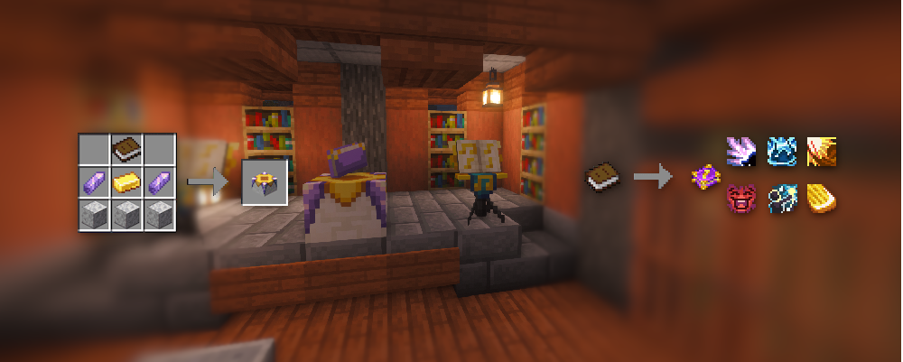

**How do you receive and cast the spells?**
* Spells from the spell book need the book equipped in the Trinket / Curious Mod's spell book slot.
* You need to have a weapon equipped, that can cast spells.
* To get a spell book, find or craft a Spell Binding Table. 
* You can find a Spell Binding Table in villages with the [Gazebos](https://curseforge.com/minecraft/mc-mods/gazebos) Mod.
* Make sure to place 18 bookshelves around the Spell Binding Table.
*  Spell Scrolls with a single spell can be found in loot chests, they can be equipped or bound with lower XP- & Lapislazuli-cost on your spell book.
* Rapiers have a Weapon Skill (Puncture) bound and Lyres and Lutes have some song-spells automatically bound on them.

**What does the Bard do?:**
* Using different instruments to play powerful music. 
* The Bard improves stats and abilities of himself and party members and makes his enemies weaker. 
* Strengths: Mobility and Stat Enhancements.
* Weaknesses: Low Armor & Damage
* Equipment: Light Armor

##  Bard's Stories (Spell Book)

| Icon | Spell | ID | Description |
|---|---|---|---|
|  | Magical Ballad | `bards_rpg:magical_ballad` | Piercing ballads that damage enemies and boost allies' offensive stats. |
|  | Vicious Mockery | `bards_rpg:vicious_mockery` | Taunts and weakens a target, so it deals less and takes more damage. |
|  | Warden's Paean | `bards_rpg:wardens_paean` | Removes the next beneficial effects of enemies and harmful effects of allies. |
|  | Encore | `bards_rpg:encore` | Damages nearby enemies and slightly reduces the cooldowns of allies' spells. |
|  | Army's Paeon | `bards_rpg:armys_paeon` | Buffs nearby allies, stronger when you damage enemies. |
|  | Crescendo | `bards_rpg:crescendo` | Stuns and damages enemies it passes through, making them take more damage. |

##  Lyre Songs

| Icon | Song | ID | Found on | Description |
|---|---|---|---|---|
|  | Natures Minne | `bards_rpg:natures_minne` | All Lyres | Damages enemies, heals allies and increases their healing taken. |
|  | Song of Celerity | `bards_rpg:song_of_celerity` | All Lyres | Damages enemies and speeds up allies. |
|  | Hymn of the Golden Light | `bards_rpg:hymn_of_the_golden_light` |  Lyre of Apollo | Damages enemies, heals allies and gives them absorption. |
|  | Song of the Turning Sky | `bards_rpg:song_of_the_turning_sky` |  Lyre of Antecael | Damages enemies, heals weak allies and protects healthy ones. |
|  | Canticles of the Tides | `bards_rpg:canticle_of_the_tides` |  Siren's Lyre | Damages enemies and heals allies in an area. |

##  Lute Songs

| Icon | Song | ID | Found on | Description |
|---|---|---|---|---|
|  | Troubadour's Minuet | `bards_rpg:troubadours_minuet` | All Lutes | Damages enemies, heals allies and reduces their damage taken. |
|  | Wanderer's Minuet | `bards_rpg:wanderers_minuet` | All Lutes | Damages enemies and boosts allies' critical chance and damage. |
|  | Tale of the Dragon Slayer | `bards_rpg:tale_of_the_dragonslayer` |  Dragon Lute | Damages enemies and boosts allies' offense and magic damage. |
|  | Discordant Note | `bards_rpg:discordant_note` |  Spellthief's Lute | Damages enemies and reduces their offensive stats. |
|  | Secret Sonata | `bards_rpg:secret_sonata` |  Lute of Ruby Verdict | Plays a random effect from the other songs, but weaker. |