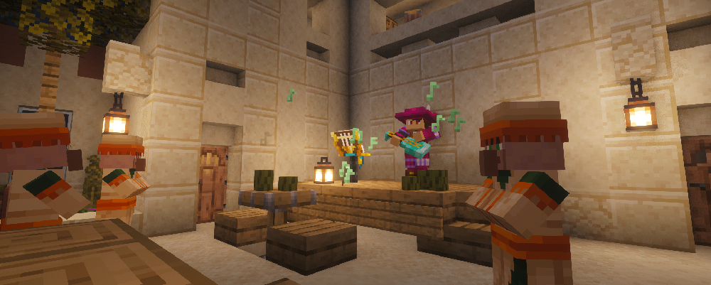
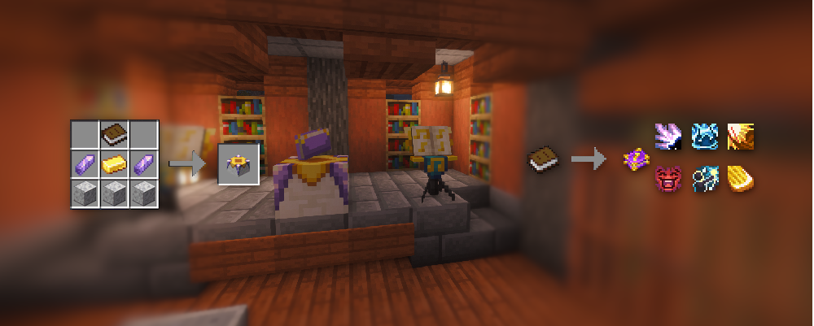
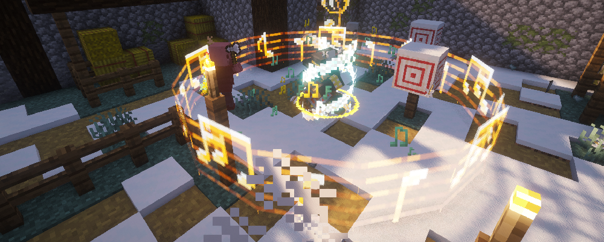
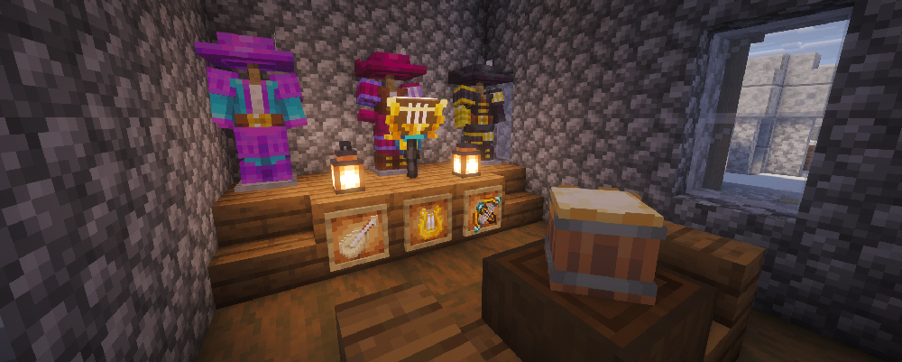

<h1>Motivate and strengthen the party with awesome songs and ballads!</h1>
    

---

## 📂 Installation

### Required Mods

<table>
<thead><tr><th>Mod</th><th>Download</th></tr></thead>
<tbody>
<tr><td><b>Spell Engine</b></td><td> </td></tr>
<tr><td><b>More RPG Library</b></td><td> </td></tr>
<tr><td><b>Armor Model API</b></td><td> </td></tr>
<tr><td><b>Structure Pool API</b></td><td> </td></tr>
<tr><td><b>Ranged Weapon API</b></td><td> </td></tr>
</tbody></table>

### Highly Recommended / Compatibility Mods

<table><thead><tr><th>Mod</th><th>Compatibility Info</th><th>Download</th></tr></thead><tbody><tr><td><b>Better Combat</b></td><td>Built in weapon animations and compat for all weapons</td><td> </td></tr><tr><td><b>BetterEnd</b></td><td>Adds higher tier weapons with materials from the End or boss loot</td><td> </td></tr><tr><td><b>BetterNether</b></td><td>Adds higher tier weapons with materials from the Nether or boss loot</td><td> </td></tr><tr><td><b>The Aether</b></td><td>Adds higher tier weapons with materials from the Aether or boss loot</td><td> </td></tr><tr><td><b>Armory (RPG Series)</b></td><td>Adds tier 5 Armor Sets for the Bard</td><td> </td></tr><tr><td><b>Arsenal (RPG Series)</b></td><td>Adds higher tier weapons with strong passives</td><td> </td></tr><tr><td><b>Loot &amp; Explore</b></td><td>Adds higher tier weapons with strong passives</td><td> </td></tr><tr><td><b>MRPGC Skill Tree Add-On</b></td><td>Adds a fully functional skill tree for the Bard</td><td> </td></tr></tbody></table>

---

## 🕹️ Features

The Bard is a supporting and enhancing class that brings the other party members and himself to a whole other level by buffing and enhancing their stats.

### Spells

Make use of the new Bard spells to make fighting and combat more fun: equip a Spell Book and unlock all of its powerful spells!

To get one, find a Spell Binding Table in village [Gazebos](https://curseforge.com/minecraft/mc-mods/gazebos), or build your own (just don't forget the bookshelves around the Spell Binding Table).

To use a spell book, equip it and hold a weapon (vanilla or from third-party mods).

**Bard's Stories**

This spell book offers supporting spells, enhancing buffs and minor heals, making the Bard a welcome ally in your party.

### Combat & Equipment

- Craft new instruments to play songs & ballads
- Craft new, fast-attacking rapiers
- Wear the Bard's garb to move faster and stay close to your allies

---

## ⚙️ Configuration

<table><thead><tr><th>Setting</th><th>File</th></tr></thead><tbody><tr><td>Armor &amp; weapon bonuses</td><td><code>config/bards_rpg/items.json</code></td></tr><tr><td>Tweaks</td><td><code>config/bards_rpg/tweaks.json</code></td></tr><tr><td>Status effects</td><td><code>config/bards_rpg/effects.json</code></td></tr></tbody></table>

---

## 🎥 Showcases

<b>Bard (RPG Series Plus) (Minecraft Mod Showcase) | A Class with Songs &amp; Buffs | 1.21.1 &amp; 1.20.1</b>

Thanks to all content creators for showcasing my mod

---

## 🙌 Credits

<table><thead><tr><th>Who</th><th>Contribution</th></tr></thead><tbody><tr><td>Daedelus</td><td>Created the amazing Spell Engine API</td></tr><tr><td><a href="https://slepykat.carrd.co/">Slepykat</a></td><td>Created all effect visual models and the music stand block</td></tr><tr><td>Damienbrittan</td><td>Created the awesome mod banner</td></tr><tr><td><a href="https://sirghaith.artstation.com/">SirGaith</a></td><td>Created the weapon &amp; armor assets</td></tr><tr><td><a href="https://emil.art/">Emil</a></td><td>Created some of the spell icons</td></tr><tr><td><a href="https://markkelly875.wixsite.com/laysquared">Laysquared Crafts</a></td><td>Created some of the spell icons</td></tr><tr><td><a href="https://www.youtube.com/@KaktusDoesMusic">KaktusDoesMusic</a></td><td>Created all the custom music &amp; sound effects</td></tr><tr><td>Florian</td><td>Built the Bard's villager structures and created the Luthier texture</td></tr></tbody></table>

---

<h3>Check out my other RPG-themed mods!</h3>
<table>
<tbody>
<tr><td align="center" style="text-align:center"></td><td align="center" style="text-align:center"></td><td align="center" style="text-align:center"></td></tr>
<tr><td align="center" style="text-align:center"></td><td align="center" style="text-align:center"></td><td align="center" style="text-align:center"></td></tr>
<tr><td align="center" style="text-align:center"></td></tr>
</tbody>
</table>

<h3>Discover more of the RPG Series by Daedelus</h3>
<table>
<tbody>
<tr><td align="center" style="text-align:center"></td><td align="center" style="text-align:center"></td><td align="center" style="text-align:center"></td></tr>
<tr><td align="center" style="text-align:center"></td><td align="center" style="text-align:center"></td><td align="center" style="text-align:center"></td></tr>
<tr><td align="center" style="text-align:center"></td><td align="center" style="text-align:center"></td><td align="center" style="text-align:center"></td></tr>
</tbody>
</table>

<h3>More RPG content by other Spell Engine devs</h3>
<table>
<tbody>
<tr><td align="center" style="text-align:center"></td><td align="center" style="text-align:center"></td><td align="center" style="text-align:center"></td></tr>
</tbody>
</table>

---

Questions, bugs or ideas? Join the <a href="https://discord.com/invite/AShKd5XrTu">Discord</a> or open an issue on <a href="https://github.com/ProfessorFichte/Bards/issues">GitHub</a>.

