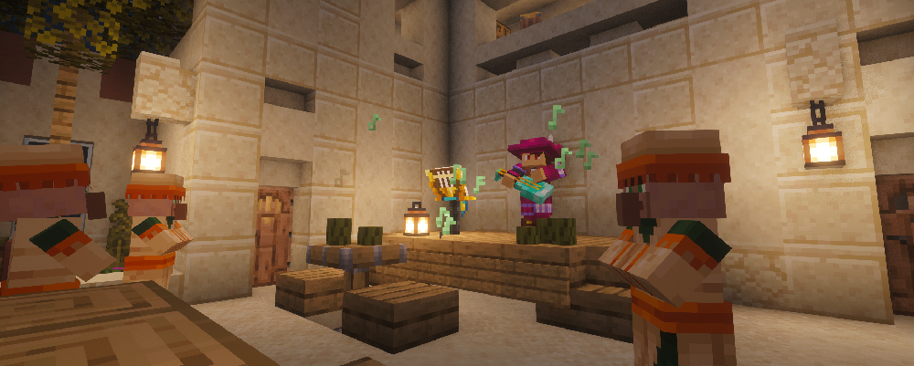
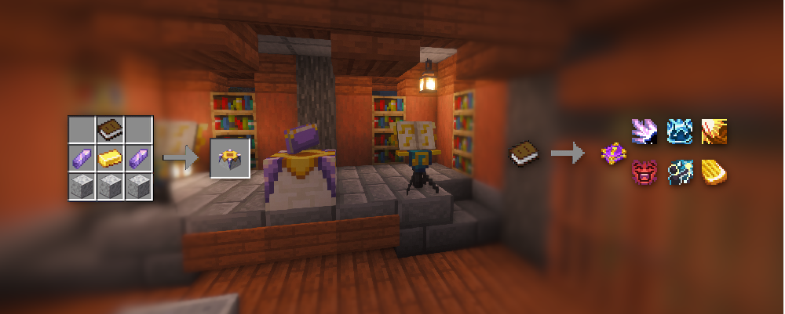
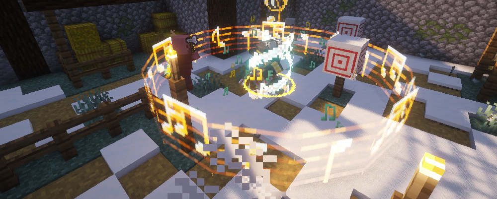
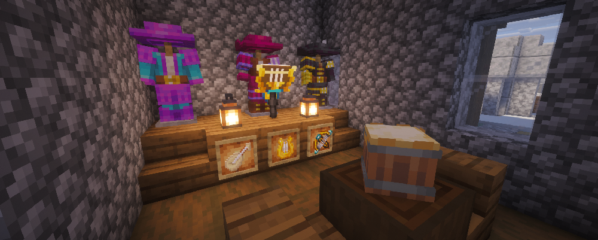

# 🎶 Motivate and strengthen the party with awesome songs and ballads!

    

---

## 📂 Installation

### 🚨 Required Mods

| Mod | Download |
|:----|:---------|
| **Spell Engine** |   |
| **More RPG Library** |   |
| **Armor Model API** |   |
| **Structure Pool API** |   |
| **Ranged Weapon API** |   |

### 👍 Highly Recommended / Compatibility Mods

<b>Show recommended & compatible mods</b>

| Mod | Compatibility Info | Download |
|:----|:-------------------|:---------|
| **Better Combat** | Built in weapon animations and compat for all weapons |   |
| **BetterEnd** | Adds higher tier weapons with materials from the End or boss loot |   |
| **BetterNether** | Adds higher tier weapons with materials from the Nether or boss loot |   |
| **The Aether** | Adds higher tier weapons with materials from the Aether or boss loot |   |
| **Armory (RPG Series)** | Adds tier 5 weapons |   |
| **Arsenal (RPG Series)** | Adds higher tier weapons with strong passives |   |
| **Loot & Explore** | Adds higher tier weapons with strong passives |   |
| **MRPGC Skill Tree Add-On** | Adds a fully functional skill tree for the Bard |   |

---

## 🕹️ Features

The Bard is a supporting and enhancing class that brings the other party members and himself to a whole other level by buffing and enhancing their stats.

### ✨ Spells

Make use of the new Bard spells to make fighting and combat more fun: equip a Spell Book and unlock all of its powerful spells!

To get one, find a Spell Binding Table in village [Gazebos](https://curseforge.com/minecraft/mc-mods/gazebos), or build your own (just don't forget the bookshelves around the Spell Binding Table).

To use a spell book, equip it and hold a weapon (vanilla or from third-party mods).

**📖 Bard's Stories**

This spell book offers supporting spells, enhancing buffs and minor heals, making the Bard a welcome ally in your party.

### 🤺 Combat & Equipment

- Craft new instruments to play songs & ballads
- Craft new, fast-attacking rapiers
- Wear the Bard's garb to move faster and stay close to your allies

---

## ⚙️ Configuration

<b>Show config files</b>

| Setting | File |
|:--------|:-----|
| Armor & weapon bonuses | `config/bards_rpg/items.json` |
| Tweaks | `config/bards_rpg/tweaks.json` |
| Status effects | `config/bards_rpg/effects.json` |

---

## 🎥 Showcases

<b>Show video</b>

▶️ **Bard (RPG Series Plus) (Minecraft Mod Showcase) | A Class with Songs & Buffs | 1.21.1 & 1.20.1**

Thanks to all content creators for showcasing my mod 😊

---

## 🙌 Credits

<b>Show credits</b>

| Who | Contribution |
|:----|:-------------|
| Daedelus | Created the amazing Spell Engine API |
| [Slepykat](https://slepykat.carrd.co/) | Created all effect visual models and the music stand block |
| Damienbrittan | Created the awesome mod banner |
| [SirGaith](https://sirghaith.artstation.com/) | Created the weapon & armor assets |
| [Emil](https://emil.art/) | Created some of the spell icons |
| [Laysquared Crafts](https://markkelly875.wixsite.com/laysquared) | Created some of the spell icons |
| [KaktusDoesMusic](https://www.youtube.com/@KaktusDoesMusic) | Created all the custom music & sound effects |
| Florian | Built the Bard's villager structures and created the Luthier texture |

---

### 🧙‍♂️ Check out my other RPG-themed mods!

|  |  |  |  |
|:-:|:-:|:-:|:-:|

### ✨ Discover more of the RPG Series by Daedelus

|  |  |  |
|:-:|:-:|:-:|
|  |  |  |
|  |  |  |

### 🌟 More RPG content by other Spell Engine devs

|  |  |  |
|:-:|:-:|:-:|

---

Questions, bugs or ideas? Join the [Discord](https://discord.com/invite/AShKd5XrTu) or open an issue on [GitHub](https://github.com/ProfessorFichte/Bards/issues).

